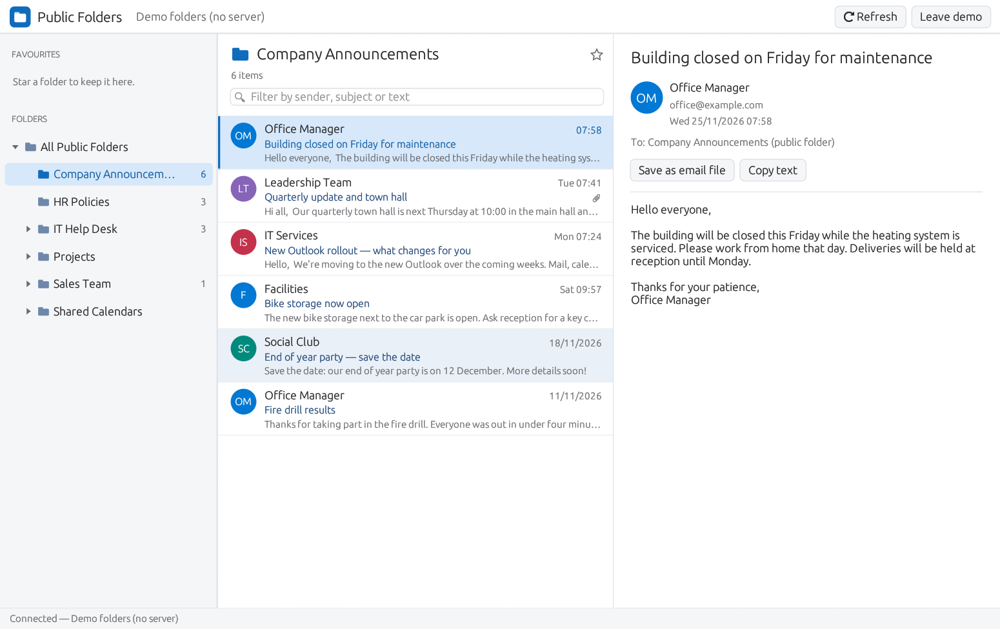
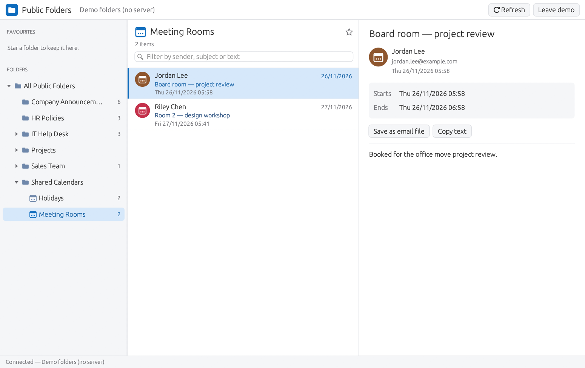
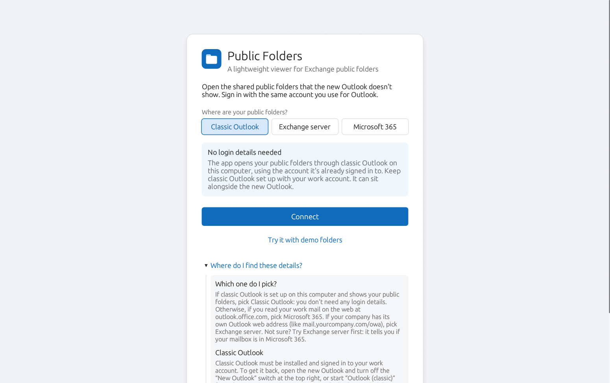

# Public Folders

**A fast, lightweight Windows app for Exchange public folders — browse them,
find any folder in a second, add e-mails and files, and export everything
for a move to SharePoint.**

The new Outlook doesn't show public folders at all, and in classic Outlook
they're slow: every folder and every list is fetched from the server again,
one click at a time. This app keeps its own map of your public folders on
your PC, so after the first visit the whole tree opens instantly — even with
tens of thousands of folders.



---

## Why use this instead of public folders in Outlook?

| | New Outlook | Classic Outlook | **This app** |
|---|---|---|---|
| Shows public folders | ❌ No | ✅ Yes | ✅ Yes |
| Speed with large public folder trees | — | Slow: public folders aren't kept offline, so every folder is fetched from the server each time | **Fast: the whole tree is mapped once (about 12 s for 11,000+ folders) and then opens in under a second** |
| Find a folder by name | — | ❌ No search for folder names | ✅ Instant "Find a folder…" across every folder, and it jumps to it in the tree |
| Remembers where you were | — | Partly | ✅ Re-opens the folders you had open and the folder you were in |
| Export a whole folder tree | — | ❌ One item at a time (drag to desktop) | ✅ One click: every folder, item and attachment, with the same tree |
| Attachments as normal files | — | ❌ Stay inside each message | ✅ Saved next to each message, ready for SharePoint |
| List of everything exported | — | ❌ | ✅ `_manifest.csv` (opens in Excel) |
| Resume an interrupted export | — | ❌ | ✅ Already-saved items are skipped |
| Add e-mails and files | — | ✅ Drag and drop | ✅ Drag and drop from Outlook or File Explorer, or Upload… |
| Import `.eml` files as real messages | — | ❌ Only as attachments | ✅ Converted into proper messages (sender, recipients, date, HTML, attachments) |
| Login details | — | Outlook's | ✅ None needed with classic Outlook installed — it uses Outlook's own sign-in |
| Install | — | Full Office | ✅ One 4 MB file, nothing to install |

### Measured on a real organisation's public folders

| Task | Through Outlook's automation | **This app** |
|---|---|---|
| Map the full folder tree (11,186 folders) | Never finished (77 folders in 25 min) | **~12 seconds** |
| Re-open the tree later | Same wait again | **0.15 seconds** (saved copy) |
| List 100 items in a folder | ~3 minutes | **~1 second** |
| Open a folder you've opened before | Same wait again | **Instant** |

Why the difference? Classic Outlook answers other programs one request at a
time on its own busy window thread (from 0.1 to 20 seconds per request was
measured), and it doesn't keep public folders offline. This app talks to
Exchange the way Outlook does internally — through **MAPI**, loaded from
Outlook's own MAPI library — where one request returns the entire folder tree,
and it saves what it learns on your PC.

---

## Features

- **Browse** the public folder tree, with mail, posts, calendar events and
  contacts, a reading pane, sender, recipients, dates and attachments.
- **Find a folder…** — instant search over every folder; picking a result
  opens the tree to it and scrolls it into view.
- **Favourites** — star folders to keep them at the top.
- **Saved copy on this PC** — the tree, item lists and opened items are
  remembered, refreshed quietly in the background (your clicks always go
  first), and updated on **Refresh**.
- **Add items** — drag e-mails straight out of Outlook (or files from File
  Explorer) onto any folder, or use **Upload…** / right-click → *Upload e-mails
  or files here…*. `.msg` and `.eml` go in as real messages (marked as
  received, not drafts); other files go in as a post with the file attached,
  like Outlook does.
- **Export one message** — right-click → *Export…* (one file) or *Export with
  attachments…* (the message plus its attachments as separate files).
- **Export a folder or everything** — right-click a folder → *Export this
  folder…*, or **Export everything…** at the top.
- **Demo folders** to try it without any server.



---

## Download and run

1. Download **[`download/Public Folders.exe`](download/Public%20Folders.exe)**
   (Windows 10/11, 64-bit). Nothing to install — put it anywhere.
2. Double-click it. The file isn't signed by a publisher, so Windows may show
   *"Windows protected your PC"* the first time: click **More info → Run anyway**.

### Signing in



- **Classic Outlook** (recommended) — no login details. Uses the classic
  Outlook already set up on the PC (it can sit alongside the new Outlook).
  If Outlook asks whether to allow a program to access your mail, choose
  **Allow**.
- **Exchange server** — your work e-mail and Outlook password (or tick
  *Sign in as me* on a company PC). The server is found automatically from
  your e-mail address.
- **Microsoft 365** — needs an app (client) ID from your IT admin (a public
  client app in Microsoft Entra with the delegated permission
  `EWS.AccessAsUser.All`). Note: Microsoft is retiring Exchange Web Services
  for Microsoft 365, so your admin may also need to keep it switched on.

---

## Moving public folders to SharePoint

1. Click **Export everything…** (or right-click a folder → *Export this folder…*).
2. Choose where to save — by default `Desktop\Public Folders Project`.
3. Leave it running; the PC stays awake. If it stops, run it again: items
   already saved are skipped.
4. Upload the folder to a SharePoint document library (or sync it with
   OneDrive).

What you get:

```
Public Folders Project\
  _manifest.csv            every item: folder, file, type, subject, from, date, status
  _export-log.txt          anything that couldn't be saved, and why
  Sales\
    Leads\
      2026-11-20 0815 - Lead from the trade fair.msg
      2026-11-20 0815 - Lead from the trade fair - attachments\
        brochure.pdf
```

Items are saved as Outlook `.msg` files (or `.eml` when connected straight
to Exchange), named by date and subject, with names made safe for Windows
and SharePoint and paths kept under the 260-character limit.

---

## How it works

| Part | How |
|---|---|
| Folder tree | Extended MAPI from Outlook's `OLMAPI32.DLL`: one hierarchy-table request for the whole tree, using long-term folder IDs that Outlook also understands |
| Item lists | MAPI contents tables (calendar and contact folders use the Outlook object model for their dates and names) |
| Opening, saving, exporting | Outlook's object model (`Outlook.Application`), through a single background worker with a two-lane queue so clicks never wait behind background work |
| `.eml` import | The e-mail is parsed and written as a MAPI message: sender, recipients, dates, headers, text and HTML bodies, attachments |
| Drag and drop | A Windows OLE drop target that accepts real files and Outlook's "virtual files" (messages arrive as `.msg`) |
| Exchange server / Microsoft 365 | Exchange Web Services, with Autodiscover, NTLMv2 / Windows sign-in / Basic, or OAuth device code |
| Saved copy | `%APPDATA%\PublicFolderViewer\cache\` (folder tree, item lists, opened items) |

Written in Rust with [egui](https://github.com/emilk/egui).

### Privacy

Everything runs on your PC. Passwords are never saved (only kept while the
app is open). Settings and the saved copy live under
`%APPDATA%\PublicFolderViewer`. The app only changes public folders when you
add items yourself.

### Limitations

- Item counts aren't shown for folders mapped through MAPI (the server
  doesn't report them in the folder list).
- The Exchange-server and Microsoft 365 connections haven't been tested
  against every server setup; classic Outlook mode is the most tested.
- Adding items (upload, drag and drop from Outlook) is new — try it with a
  test folder first.
- Windows only.

---

## Building from source

Requires [Rust](https://rustup.rs).

```
cargo build --release
```

The program is `target\release\public-folders.exe`. Command-line options:
`--demo` (open the demo folders), `--demo-folder <id>`, `--screenshot <file.png>`.

With the usual MSVC Rust toolchain nothing else is needed. If you build with
the GNU toolchain on a PC without MinGW, copy
`tools/cargo-config-gnu.example.toml` to `.cargo/config.toml` and fill in
the two paths (it links with Rust's bundled `rust-lld`; `tools/dlltool.cmd`
stands in for MinGW's dlltool).

Tests: `cargo test`. Live checks against classic Outlook (read-only) are
marked `#[ignore]` — for example `cargo test live_mapping -- --ignored --nocapture`.
